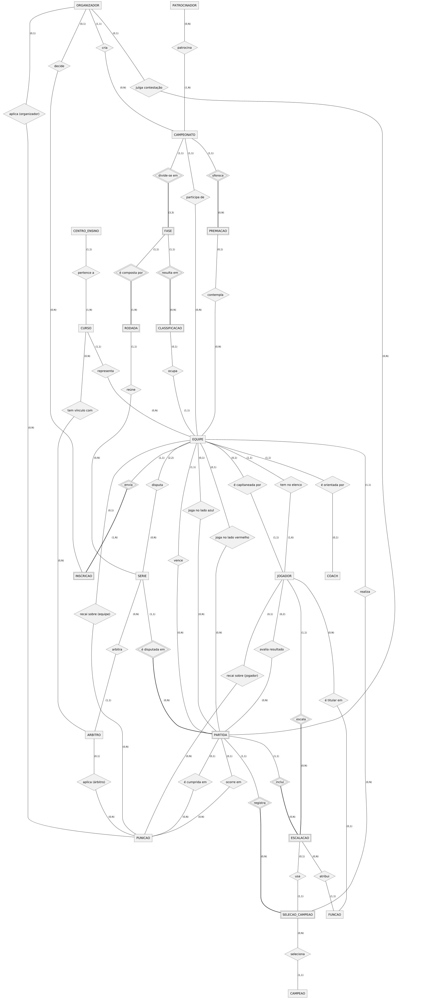
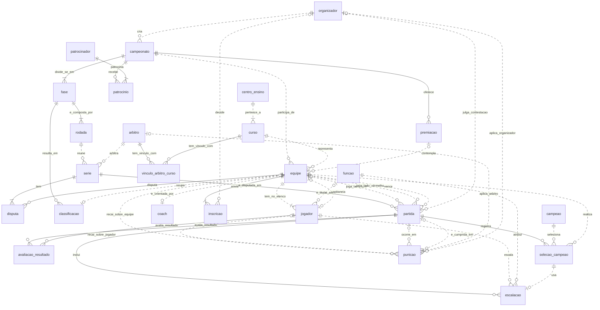

# Copa UFSC de League of Legends — Banco de Dados

Banco de dados relacional para um campeonato universitário de League of Legends, com uma equipe por curso de graduação do campus Florianópolis da UFSC.

- **Autor:** Mateus Nunes Oliveira
- **Disciplina:** CIN 8003 – Bancos de Dados e Aplicações (UFSC)
- **Professor:** Moisés Lima Dutra
- **Semestre:** 2026.2
- **SGBD:** SQLite 3

> Projeto acadêmico. O campeonato é fictício e não é um evento oficial da Riot Games. Todos os nomes de pessoas, Riot IDs, e-mails e telefones são sintéticos; cursos, centros de ensino e campeões são reais.

---

## Resumo do cenário

O campeonato tem **64 vagas**, uma para cada curso de graduação presencial do campus Florianópolis (11 Centros de Ensino). Cada equipe tem 6 jogadores do próprio curso (5 titulares, um por função, e 1 reserva), um capitão e, se quiser, um coach. Um organizador cria o campeonato, aprova as inscrições e julga contestações; árbitros conduzem as séries e registram cada partida (lados, escalação, banimentos e escolhas de campeões, vencedora, duração).

O campeonato tem três fases:

| Fase | Equipes | Formato |
|---|---|---|
| Play-in | 64 → 16 | eliminatória simples em 2 rodadas, séries em melhor de 3 (Md3) |
| Fase Suíça | 16 → 8 | séries Md1; 3 vitórias classificam e 3 derrotas eliminam |
| Playoffs | 8 → 1 | quartas e semifinais em Md3, final em Md5 |

O modelo também cobre punições (advertência, suspensão, desqualificação), patrocínio e premiação. São **8 stakeholders**, **17 requisitos funcionais** e **35 regras de negócio** (RN01 a RN28 do cenário e RN29 a RN35 complementares).

---

## Estrutura do repositório

| Pasta / arquivo | Conteúdo |
|---|---|
| [README.md](README.md) | esta página |
| [links.txt](links.txt) | todas as URLs externas usadas no projeto e na apresentação |
| **docs/** | documentos de cada etapa |
| [docs/01_requisitos.md](docs/01_requisitos.md) | modelo de requisitos |
| [docs/02_modelo_conceitual.md](docs/02_modelo_conceitual.md) | modelo conceitual (MER) |
| [docs/03_modelo_logico.md](docs/03_modelo_logico.md) | modelo lógico (esquema relacional) |
| [docs/04_projeto_fisico.md](docs/04_projeto_fisico.md) | projeto físico (SQLite) |
| [docs/img/](docs/img/) | diagramas exportados em PNG: [MER – visão geral](docs/img/mer_visao_geral.png), [área 1](docs/img/mer_completo_1_estrutura.png), [área 2](docs/img/mer_completo_2_equipes_pessoas.png), [área 3](docs/img/mer_completo_3_partida_draft.png), [área 4](docs/img/mer_completo_4_punicoes_patrocinio_premiacao.png), [esquema relacional](docs/img/esquema_relacional.png) |
| [diagramas/](diagramas/) | código-fonte dos diagramas (PlantUML `.puml` e Mermaid `.mmd`) |
| **sql/** | scripts SQL |
| [sql/script_ddl.sql](sql/script_ddl.sql) | criação das 25 tabelas (DDL) |
| [sql/script_dml.sql](sql/script_dml.sql) | carga de dados (DML) |
| [sql/testes_integridade.sql](sql/testes_integridade.sql) | testes das restrições de integridade |
| [sql/verificacao_regras.sql](sql/verificacao_regras.sql) | consultas de auditoria das regras garantidas pela aplicação |
| **consultas/** | as 10 consultas SQL: [1](consultas/consulta1.sql), [2](consultas/consulta2.sql), [3](consultas/consulta3.sql), [4](consultas/consulta4.sql), [5](consultas/consulta5.sql), [6](consultas/consulta6.sql), [7](consultas/consulta7.sql), [8](consultas/consulta8.sql), [9](consultas/consulta9.sql), [10](consultas/consulta10.sql) |
| [banco/campeonato_lol_ufsc.db](banco/campeonato_lol_ufsc.db) | banco SQLite criado e carregado |
| [python/gerar_dados.py](python/gerar_dados.py) | gerador dos dados sintéticos do `script_dml.sql` |
| **apresentacao/** | slides: [apresentacao.pptx](apresentacao/apresentacao.pptx) e [apresentacao.pdf](apresentacao/apresentacao.pdf) |

---

## Etapas do projeto

| # | Etapa | Produto | Arquivos |
|---|---|---|---|
| 1 | Levantamento e análise de requisitos | stakeholders, RF, RN, casos de uso, RNF e LGPD | [docs/01_requisitos.md](docs/01_requisitos.md) |
| 2 | Modelo conceitual | MER em notação de Chen: 21 entidades e 40 relacionamentos | [docs/02_modelo_conceitual.md](docs/02_modelo_conceitual.md) |
| 3 | Modelo lógico | esquema relacional com 25 relações em 3FN | [docs/03_modelo_logico.md](docs/03_modelo_logico.md) |
| 4 | Projeto físico | DDL no SQLite: 25 tabelas, 44 chaves estrangeiras | [docs/04_projeto_fisico.md](docs/04_projeto_fisico.md), [sql/script_ddl.sql](sql/script_ddl.sql) |
| 5 | Carga de dados | DML com 6.251 linhas e banco `.db` | [sql/script_dml.sql](sql/script_dml.sql), [banco/campeonato_lol_ufsc.db](banco/campeonato_lol_ufsc.db) |
| 6 | Consultas | 10 consultas SQL | [consultas/](consultas/) |
| 7 | Apresentação | slides | [apresentacao/](apresentacao/) |

---

## Modelo conceitual (MER)

Visão geral, com entidades, relacionamentos e cardinalidades (notação de Chen). Os atributos estão nas quatro áreas detalhadas, em [docs/img/](docs/img/).



---

## Esquema do banco (Mermaid)

Tabelas do banco e as ligações entre elas (chaves estrangeiras). As colunas estão em [docs/03_modelo_logico.md](docs/03_modelo_logico.md) e em [sql/script_ddl.sql](sql/script_ddl.sql). Linha cheia: a tabela filha é entidade fraca ou associativa; linha tracejada: chave estrangeira comum.



---

## Como executar

### Opção 1 — SQLite Online, abrindo o banco pronto

1. Baixe [banco/campeonato_lol_ufsc.db](banco/campeonato_lol_ufsc.db) (no GitHub, abra o arquivo e clique em *Download raw file*).
2. Acesse https://sqliteonline.com, escolha **SQLite** e use **File → Open DB** para abrir o arquivo.
3. Rode `PRAGMA foreign_keys = ON;`.
4. Abra uma consulta da pasta [consultas/](consultas/), cole no editor e clique em **Run**.

### Opção 2 — SQLite Online, criando o banco pelos scripts

1. Em https://sqliteonline.com, com um banco SQLite vazio, cole [sql/script_ddl.sql](sql/script_ddl.sql) e clique em **Run**.
2. Depois cole [sql/script_dml.sql](sql/script_dml.sql) e clique em **Run**.
3. Rode as consultas como na opção 1.

A ordem importa: o DML só funciona depois que as tabelas existem. O DDL começa apagando as tabelas, então pode ser executado de novo.

### Opção 3 — sqlite3 na linha de comando

Criar o banco pelos scripts:

```bash
sqlite3 banco/campeonato_lol_ufsc.db < sql/script_ddl.sql
sqlite3 banco/campeonato_lol_ufsc.db < sql/script_dml.sql
```

Rodar uma consulta:

```bash
sqlite3 banco/campeonato_lol_ufsc.db
sqlite> PRAGMA foreign_keys = ON;
sqlite> .headers on
sqlite> .read consultas/consulta1.sql
```

### Opção 4 — Python (`sqlite3`)

```python
import sqlite3

con = sqlite3.connect('banco/campeonato_lol_ufsc.db')
con.execute('PRAGMA foreign_keys = ON')
sql = open('consultas/consulta1.sql', encoding='utf-8').read()
for linha in con.execute(sql):
    print(linha)
con.close()
```

Esse exemplo serve para as consultas 1 a 8, que têm um só comando. As consultas 9 e 10 têm vários comandos (transação); rode-as pelo SQLite Online ou pela linha de comando.

Os dados do `script_dml.sql` foram gerados por [python/gerar_dados.py](python/gerar_dados.py), com semente fixa (sempre gera os mesmos dados).

---

## As 10 consultas

| Nº | Arquivo | Pergunta | Técnicas |
|---|---|---|---|
| 1 | [consulta1.sql](consultas/consulta1.sql) | Quantos cursos cada centro de ensino tem no campeonato? | COUNT · INNER JOIN · GROUP BY · ORDER BY DESC |
| 2 | [consulta2.sql](consultas/consulta2.sql) | Quais árbitros apitaram mais de 8 horas de jogo? | SUM · INNER JOIN (3 tabelas) · GROUP BY · HAVING |
| 3 | [consulta3.sql](consultas/consulta3.sql) | Qual a duração média das partidas em cada fase e formato de série? | AVG · INNER JOIN (4 tabelas) · GROUP BY com 2 colunas · ORDER BY ASC |
| 4 | [consulta4.sql](consultas/consulta4.sql) | Qual a vitória mais curta e a mais longa de cada curso com 5 vitórias ou mais? | MIN · MAX · INNER JOIN · GROUP BY · HAVING |
| 5 | [consulta5.sql](consultas/consulta5.sql) | Quanto cada patrocinador pagou de cota, inclusive quem não patrocinou? | LEFT JOIN (3 tabelas) · COALESCE · ORDER BY DESC |
| 6 | [consulta6.sql](consultas/consulta6.sql) | Quais partidas duraram mais que a duração média? | subconsulta escalar · AVG · ORDER BY DESC |
| 7 | [consulta7.sql](consultas/consulta7.sql) | Quais séries tiveram partida perdida por suspensão? | subconsulta com EXISTS · IS NULL |
| 8 | [consulta8.sql](consultas/consulta8.sql) | Quantas vitórias tiveram as 8 equipes classificadas da Fase Suíça? | CTE (WITH) · subconsulta com IN · INNER JOIN · ORDER BY DESC |
| 9 | [consulta9.sql](consultas/consulta9.sql) | O árbitro 1 adverte a equipe 21: dá para desfazer sem perder nada? | BEGIN · SAVEPOINT · ROLLBACK TO · COMMIT |
| 10 | [consulta10.sql](consultas/consulta10.sql) | O organizador 1 corrige o vencedor da partida 1: dá para desfazer? | BEGIN · SAVEPOINT · ROLLBACK TO · COMMIT |

**Onde está cada técnica:** funções de agregação COUNT (1), SUM (2), AVG (3, 6), MIN e MAX (4) · INNER JOIN (1, 2, 3, 4, 8) · LEFT JOIN com 3 tabelas (5) · HAVING (2, 4) · subconsulta escalar (6), com EXISTS (7) e com IN (8) · CTE (8) · tratamento de nulos (5, 7) · GROUP BY com 2 colunas (3) · ordenação ascendente (3) e descendente (1, 5, 6, 8) · transações com COMMIT, ROLLBACK e SAVEPOINT (9, 10).

Nas consultas 9 e 10, a alteração é desfeita com `ROLLBACK TO` antes do `COMMIT`: o banco termina igual e a consulta pode ser executada de novo.
