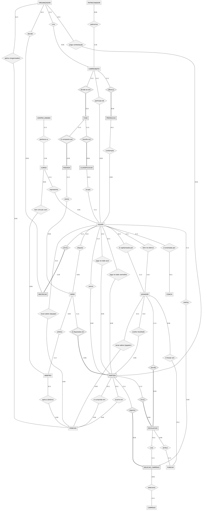
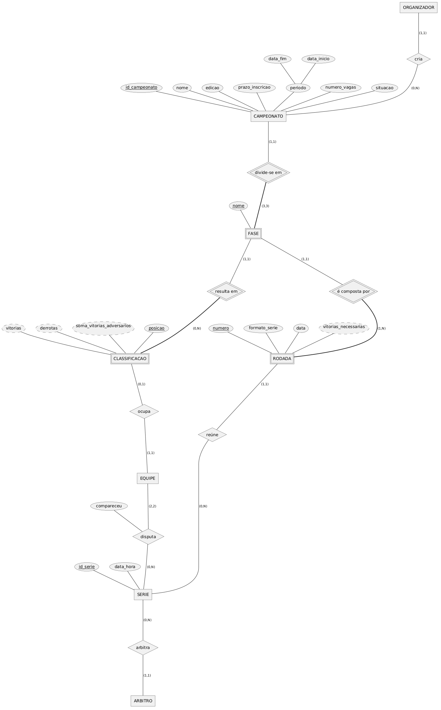
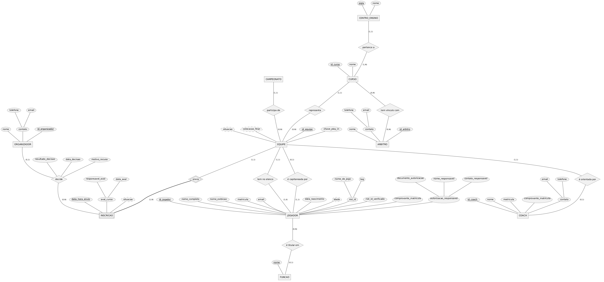
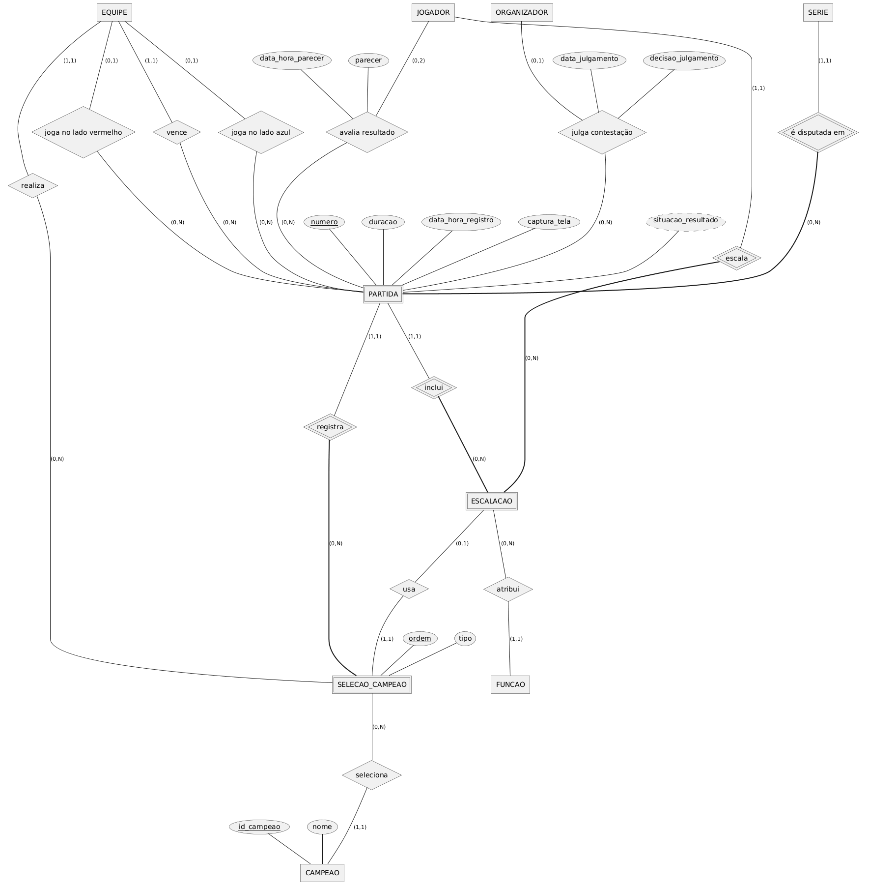
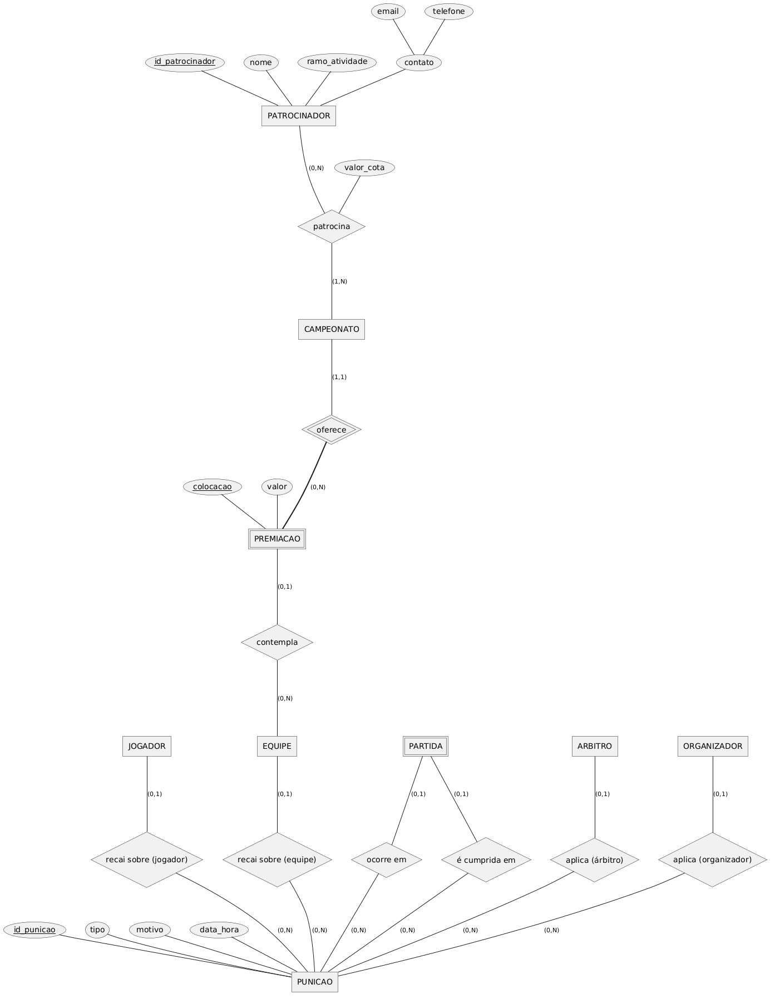

# 02 — Modelo Conceitual (MER)

**Campeonato universitário de League of Legends — UFSC, campus Florianópolis**

CIN 8003 – Bancos de Dados e Aplicações · Prof. Moisés Lima Dutra · Aluno: Mateus Nunes Oliveira

> Feito a partir do documento de requisitos (Parte 1). Não há tabelas, tipos de dados nem SQL.

**Convenção de cardinalidade: leitura pelo lado oposto.** Para "para cada A, quantos B?", o par (mín, máx) fica **junto de B**. Uso (0,1), (1,1), (0,N) e (1,N). Quando a regra fixa um número exato, uso o número, por exemplo (2,2).

**Legenda:** forte = retângulo; fraca = retângulo duplo, ligada à dona por losango duplo e linha dupla; identificador = sublinhado; **(C)** = atributo composto; **(D)** = atributo derivado (elipse tracejada).

---

## 2. Entidades

Para cada candidato fiz 4 perguntas (várias ocorrências? informações próprias? identidade própria? dá para distinguir?). As 21 entidades do cenário foram mantidas. As que **não têm identidade própria** (só são distinguidas dentro de outra) viraram **fracas**.

| Entidade | Tipo | Por quê |
|---|---|---|
| CAMPEONATO | forte | uma por edição |
| FASE | fraca (de CAMPEONATO) | "Fase Suíça" existe em toda edição |
| RODADA | fraca (de FASE) | "rodada 2" se repete em toda fase |
| SERIE | forte | confronto entre duas equipes |
| PARTIDA | fraca (de SERIE) | "partida 2" só existe dentro da série |
| EQUIPE | forte | existe dentro de um campeonato |
| JOGADOR | forte | um registro por campeonato |
| COACH | forte | um registro por campeonato |
| CURSO | forte | permanente |
| CENTRO_ENSINO | forte | permanente |
| INSCRICAO | fraca (de EQUIPE) | cada envio da equipe, inclusive o reenvio (RN09) |
| FUNCAO | forte | as 5 funções do jogo |
| ESCALACAO | fraca (de PARTIDA e JOGADOR) | "jogador X na partida Y" |
| CAMPEAO | forte | catálogo do jogo |
| SELECAO_CAMPEAO | fraca (de PARTIDA) | cada escolha ou banimento do draft |
| CLASSIFICACAO | fraca (de FASE) | as 8 posições oficiais da Fase Suíça |
| ARBITRO | forte | |
| PUNICAO | forte | pode recair sobre jogador ou equipe |
| ORGANIZADOR | forte | |
| PATROCINADOR | forte | |
| PREMIACAO | fraca (de CAMPEONATO) | uma por colocação premiada |

**Não viraram entidade:** espectador (o sistema não guarda dados sobre ele); capitão (relacionamento); lado azul/vermelho (dois relacionamentos); W.O. (atributo `compareceu`); cota (atributo do relacionamento `patrocina`); advertência, suspensão e desqualificação (valores de `PUNICAO.tipo`); responsável legal e aval do curso (atributos compostos).

**Decisões principais:**
- **Classificação:** é entidade porque a posição final pode sair de sorteio (RN14), que não dá para calcular. Vitórias e derrotas são derivadas.
- **Série × Equipe:** um relacionamento `disputa` (2,2). **Partida × Equipe:** dois relacionamentos, lado azul e lado vermelho, porque os papéis são diferentes (RN19).
- **Escalação e Seleção de Campeão:** entidades, não ternários. A escolha do campeão precisa apontar para o jogador escalado naquela partida.
- **Capitão:** relacionamento (1,1) com JOGADOR. **Coach:** (0,1) por equipe.
- **Punição:** dois relacionamentos opcionais, um com JOGADOR e outro com EQUIPE.
- **Premiação:** uma ocorrência por colocação. "Semifinalista" contempla duas equipes, então as duas recebem o mesmo valor (RN28).

**Premissas:**
- P1: jogador e coach são registrados por campeonato.
- P2: cada envio de inscrição é uma ocorrência.
- P3: a série já nasce com árbitro.
- P4: a partida perdida por suspensão (RN27) é registrada sem lados, escalação nem seleção.
- P5: contato é composto (e-mail, telefone).

---

## 3. Atributos

| Entidade | Atributos |
|---|---|
| CAMPEONATO | <u>id_campeonato</u>, nome, edicao, prazo_inscricao, periodo (C: data_inicio, data_fim), numero_vagas, situacao |
| FASE | <u>nome</u> |
| RODADA | <u>numero</u>, formato_serie, data, vitorias_necessarias (D) |
| SERIE | <u>id_serie</u>, data_hora |
| PARTIDA | <u>numero</u>, duracao, captura_tela, data_hora_registro, situacao_resultado (D) |
| EQUIPE | <u>id_equipe</u>, chave_play_in, situacao (D), colocacao_final (D) |
| JOGADOR | <u>id_jogador</u>, nome_completo, nome_exibicao, matricula, email, data_nascimento, idade (D), riot_id (C: nome_de_jogo, tag), riot_id_verificado, comprovante_matricula, autorizacao_responsavel (C: nome_responsavel, contato_responsavel, documento_autorizacao) |
| COACH | <u>id_coach</u>, nome, matricula, comprovante_matricula, contato (C: email, telefone) |
| CURSO | <u>id_curso</u>, nome |
| CENTRO_ENSINO | <u>sigla</u>, nome |
| INSCRICAO | <u>data_hora_envio</u>, aval_curso (C: responsavel_aval, data_aval), situacao (D) |
| FUNCAO | <u>nome</u> |
| ESCALACAO | (sem atributos próprios) |
| CAMPEAO | <u>id_campeao</u>, nome |
| SELECAO_CAMPEAO | <u>ordem</u>, tipo |
| CLASSIFICACAO | <u>posicao</u>, vitorias (D), derrotas (D), soma_vitorias_adversarios (D) |
| ARBITRO | <u>id_arbitro</u>, nome, contato (C: email, telefone) |
| PUNICAO | <u>id_punicao</u>, tipo, motivo, data_hora |
| ORGANIZADOR | <u>id_organizador</u>, nome, contato (C: email, telefone) |
| PATROCINADOR | <u>id_patrocinador</u>, nome, ramo_atividade, contato (C: email, telefone) |
| PREMIACAO | <u>colocacao</u>, valor |

**Multivalorados:** nenhum. Os cursos com que o árbitro tem vínculo viraram um relacionamento com CURSO.

**Fora de propósito:** o curso do jogador e do coach não é atributo deles, porque é o curso da equipe (RN03, RN07).

---

## 4. Identificadores

- **Artificiais (`id_...`):** usados quando não havia um atributo natural único, estável e válido para todas as ocorrências. Exemplos: o nome do curso pode mudar; a matrícula se repete entre edições; o Riot ID pode mudar (RN29).
- **Naturais:** `sigla` (CENTRO_ENSINO) e `nome` (FUNCAO).
- **Entidades fracas:** identificador da dona + identificador parcial.

| Entidade fraca | Identificador |
|---|---|
| FASE | campeonato + nome |
| RODADA | fase + numero |
| PARTIDA | série + numero |
| INSCRICAO | equipe + data_hora_envio |
| ESCALACAO | partida + jogador |
| SELECAO_CAMPEAO | partida + ordem |
| CLASSIFICACAO | fase + posicao |
| PREMIACAO | campeonato + colocacao |

---

## 5. Relacionamentos

◆ = relacionamento identificador (de entidade fraca). Não há autorrelacionamentos nem ternários.

| R | Leitura | RN |
|---|---|---|
| R01 | ORGANIZADOR **cria** CAMPEONATO | RF01 |
| R02 | CAMPEONATO **divide-se em** FASE ◆ | cenário |
| R03 | FASE **é composta por** RODADA ◆ | RN10, RN12, RN16 |
| R04 | RODADA **reúne** SERIE | cenário |
| R05 | EQUIPE **disputa** SERIE | RN18 |
| R06 | ARBITRO **arbitra** SERIE | RN24 |
| R07 | FASE **resulta em** CLASSIFICACAO ◆ | RN14 |
| R08 | EQUIPE **ocupa** CLASSIFICACAO | RN14, RN15 |
| R09 | EQUIPE **participa de** CAMPEONATO | RN09 |
| R10 | EQUIPE **representa** CURSO | RN01 |
| R11 | CURSO **pertence a** CENTRO_ENSINO | cenário |
| R12 | EQUIPE **envia** INSCRICAO ◆ | RN09 |
| R13 | ORGANIZADOR **decide** INSCRICAO | RN09 |
| R14 | EQUIPE **tem no elenco** JOGADOR | RN02 |
| R15 | EQUIPE **é capitaneada por** JOGADOR | RN06 |
| R16 | EQUIPE **é orientada por** COACH | RN07 |
| R17 | JOGADOR **é titular em** FUNCAO | RN02 |
| R18 | ARBITRO **tem vínculo com** CURSO | RN24 |
| R19 | SERIE **é disputada em** PARTIDA ◆ | RN17 |
| R20 | EQUIPE **joga no lado azul** da PARTIDA | RN19 |
| R21 | EQUIPE **joga no lado vermelho** da PARTIDA | RN19 |
| R22 | EQUIPE **vence** PARTIDA | RN25 |
| R23 | JOGADOR (capitão) **avalia resultado** da PARTIDA | RN25 |
| R24 | ORGANIZADOR **julga contestação** da PARTIDA | RN25 |
| R25 | PARTIDA **inclui** ESCALACAO ◆ | RN20 |
| R26 | ESCALACAO **escala** JOGADOR ◆ | RN20, RN21 |
| R27 | ESCALACAO **atribui** FUNCAO | RN20 |
| R28 | PARTIDA **registra** SELECAO_CAMPEAO ◆ | RN21 |
| R29 | SELECAO_CAMPEAO **seleciona** CAMPEAO | RN21, RN22 |
| R30 | EQUIPE **realiza** SELECAO_CAMPEAO | RN19 |
| R31 | ESCALACAO **usa** SELECAO_CAMPEAO (o campeão escolhido) | domínio: cada jogador controla um campeão |
| R32 | PATROCINADOR **patrocina** CAMPEONATO | RN28 |
| R33 | CAMPEONATO **oferece** PREMIACAO ◆ | RN28 |
| R34 | PREMIACAO **contempla** EQUIPE | RN28 |
| R35 | PUNICAO **recai sobre** JOGADOR | RN27 |
| R36 | PUNICAO **recai sobre** EQUIPE | RN27, RN34 |
| R37 | PUNICAO **ocorre em** PARTIDA (onde houve a conduta) | RN27 |
| R38 | PUNICAO **é cumprida em** PARTIDA (partida seguinte) | RN21, RN27, RN34 |
| R39 | ARBITRO **aplica** PUNICAO | RN27, RN34 |
| R40 | ORGANIZADOR **aplica** PUNICAO | RN27 |

---

## 6. Atributos de relacionamentos

Pergunta: *a informação descreve uma entidade sozinha ou só faz sentido com as entidades relacionadas?*

| R | Atributos |
|---|---|
| R05 disputa | compareceu |
| R13 decide | resultado_decisao, data_decisao, motivo_recusa |
| R23 avalia_resultado | parecer (confirma/contesta), data_hora_parecer |
| R24 julga_contestacao | decisao_julgamento, data_julgamento |
| R32 patrocina | valor_cota |

Nos demais relacionamentos, a resposta foi "descreve uma das entidades" ou "não há informação própria". Por isso, eles não têm atributos.

---

## 7. Cardinalidades

Pergunta 1: "para cada A, quantos B?" (par junto de B). Pergunta 2: "para cada B, quantos A?" (par junto de A).

| R | Para cada A, quantos B? | Par (junto de B) | Para cada B, quantos A? | Par (junto de A) | RN |
|---|---|---|---|---|---|
| R01 cria | ORGANIZADOR → CAMPEONATOS | (0,N) | CAMPEONATO → ORGANIZADORES | (1,1) | RF01 |
| R02 divide_se_em | CAMPEONATO → FASES | (3,3) | FASE → CAMPEONATOS | (1,1) | cenário |
| R03 e_composta_por | FASE → RODADAS | (1,N) | RODADA → FASES | (1,1) | RN10, RN12, RN16 |
| R04 reune | RODADA → SERIES | (0,N) | SERIE → RODADAS | (1,1) | RF07 |
| R05 disputa | SERIE → EQUIPES | (2,2) | EQUIPE → SERIES | (0,N) | RN18 |
| R06 arbitra | SERIE → ARBITROS | (1,1) | ARBITRO → SERIES | (0,N) | RN24 |
| R07 resulta_em | FASE → CLASSIFICACOES | (0,N) | CLASSIFICACAO → FASES | (1,1) | RN14 (só a Suíça tem 8) |
| R08 ocupa | EQUIPE → CLASSIFICACOES | (0,1) | CLASSIFICACAO → EQUIPES | (1,1) | RN12, RN14 |
| R09 participa_de | CAMPEONATO → EQUIPES | (0,N) | EQUIPE → CAMPEONATOS | (1,1) | RN09 (até 64) |
| R10 representa | CURSO → EQUIPES | (0,N) | EQUIPE → CURSOS | (1,1) | RN01 |
| R11 pertence_a | CENTRO_ENSINO → CURSOS | (1,N) | CURSO → CENTROS | (1,1) | cenário |
| R12 envia | EQUIPE → INSCRICOES | (1,N) | INSCRICAO → EQUIPES | (1,1) | RN09 (reenvio) |
| R13 decide | ORGANIZADOR → INSCRICOES | (0,N) | INSCRICAO → ORGANIZADORES | (0,1) | RN09 (pendente) |
| R14 tem_no_elenco | EQUIPE → JOGADORES | (1,6) | JOGADOR → EQUIPES | (1,1) | RN02, RN04 |
| R15 e_capitaneada_por | EQUIPE → JOGADORES capitães | (1,1) | JOGADOR → EQUIPES que capitaneia | (0,1) | RN06 |
| R16 e_orientada_por | EQUIPE → COACHES | (0,1) | COACH → EQUIPES | (1,1) | RN07 |
| R17 e_titular_em | JOGADOR → FUNCOES | (0,1) | FUNCAO → JOGADORES | (0,N) | RN02 (reserva sem função) |
| R18 tem_vinculo_com | ARBITRO → CURSOS | (0,N) | CURSO → ARBITROS | (0,N) | RN24 |
| R19 e_disputada_em | SERIE → PARTIDAS | (0,N) | PARTIDA → SERIES | (1,1) | RN17, RN26 (0 no W.O.) |
| R20 joga_lado_azul | EQUIPE → PARTIDAS | (0,N) | PARTIDA → EQUIPES no azul | (0,1) | RN19; P4 |
| R21 joga_lado_vermelho | EQUIPE → PARTIDAS | (0,N) | PARTIDA → EQUIPES no vermelho | (0,1) | RN19; P4 |
| R22 vence | EQUIPE → PARTIDAS | (0,N) | PARTIDA → EQUIPES vencedoras | (1,1) | RN25 |
| R23 avalia_resultado | PARTIDA → JOGADORES (capitães) | (0,2) | JOGADOR → PARTIDAS | (0,N) | RN25 |
| R24 julga_contestacao | ORGANIZADOR → PARTIDAS | (0,N) | PARTIDA → ORGANIZADORES | (0,1) | RN25 |
| R25 inclui | PARTIDA → ESCALACOES | (0,N) | ESCALACAO → PARTIDAS | (1,1) | RN20 (10 por partida) |
| R26 escala | JOGADOR → ESCALACOES | (0,N) | ESCALACAO → JOGADORES | (1,1) | RN20 |
| R27 atribui | ESCALACAO → FUNCOES | (1,1) | FUNCAO → ESCALACOES | (0,N) | RN20 |
| R28 registra | PARTIDA → SELECOES | (0,N) | SELECAO_CAMPEAO → PARTIDAS | (1,1) | RN21 (até 20) |
| R29 seleciona | SELECAO_CAMPEAO → CAMPEOES | (1,1) | CAMPEAO → SELECOES | (0,N) | RN21 |
| R30 realiza | SELECAO_CAMPEAO → EQUIPES | (1,1) | EQUIPE → SELECOES | (0,N) | RN19 |
| R31 usa | ESCALACAO → SELECOES | (1,1) | SELECAO_CAMPEAO → ESCALACOES | (0,1) | banimento não tem jogador |
| R32 patrocina | CAMPEONATO → PATROCINADORES | (0,N) | PATROCINADOR → CAMPEONATOS | (1,N) | RN28 |
| R33 oferece | CAMPEONATO → PREMIACOES | (0,N) | PREMIACAO → CAMPEONATOS | (1,1) | RN28 |
| R34 contempla | EQUIPE → PREMIACOES | (0,1) | PREMIACAO → EQUIPES | (0,N) | RN28 (semifinalista: 2) |
| R35 recai_sobre_jogador | JOGADOR → PUNICOES | (0,N) | PUNICAO → JOGADORES | (0,1) | RN27 |
| R36 recai_sobre_equipe | EQUIPE → PUNICOES | (0,N) | PUNICAO → EQUIPES | (0,1) | RN27, RN34 |
| R37 ocorre_em | PARTIDA → PUNICOES | (0,N) | PUNICAO → PARTIDAS | (0,1) | RN27 |
| R38 e_cumprida_em | PARTIDA → PUNICOES | (0,N) | PUNICAO → PARTIDAS | (0,1) | RN27, RN34 |
| R39 aplica_arbitro | ARBITRO → PUNICOES | (0,N) | PUNICAO → ARBITROS | (0,1) | RN27 |
| R40 aplica_organizador | ORGANIZADOR → PUNICOES | (0,N) | PUNICAO → ORGANIZADORES | (0,1) | RN27 |

---

## 8. Diagrama

Feito em PlantUML (notação de Chen). Como o diagrama com todos os atributos ficava ilegível, ele foi dividido em uma visão geral e quatro áreas. Os arquivos-fonte estão em `diagramas/`.

**Visão geral** (entidades, relacionamentos e cardinalidades):

**Área 1 — Estrutura do campeonato:**

**Área 2 — Equipes e pessoas:**

**Área 3 — Partida e draft:**

**Área 4 — Punições, patrocínio e premiação:**

Nas áreas, uma entidade de outra área aparece sem atributos.

---

## 9. Validação

**a) As informações dos requisitos estão no modelo?** Sim. As 15 categorias da seção 4 dos requisitos têm entidade, atributo ou relacionamento correspondente.

**b) Os casos de uso críticos podem ser explicados?** Sim.
- **UC01 (registrar partida):** SERIE → PARTIDA → lados, ESCALACAO, SELECAO_CAMPEAO, `vence`, `avalia_resultado`.
- **UC02 (aprovar inscrição):** EQUIPE → INSCRICAO → elenco, curso, documentos do jogador → `decide`.

**c) As regras são compatíveis com as cardinalidades?** Sim. Por exemplo: RN18 → (2,2); RN06 → capitão (1,1); RN07 → coach (0,1); RN24 → árbitro (1,1). As regras que a cardinalidade não consegue mostrar estão na matriz abaixo.

**d) Existe entidade sem função?** Não.

**e) Existe relacionamento sem justificativa?** Não. Todos citam uma regra ou requisito (seção 5).

**f) Existe atributo na entidade errada?** Não. O curso fica na equipe; a cota, a decisão e o comparecimento ficam nos relacionamentos.

**g) Alguma dúvida virou decisão sem justificativa?** Não. As dúvidas D01–D14 foram respondidas pelo cliente, e as escolhas próprias estão listadas como premissas P1–P5.

**h) O modelo depende de SQL ou de um SGBD?** Não.

**Matriz de rastreabilidade** ("aplicação/físico" = não representável no MER; será tratada no físico ou na aplicação):

| RN | Elemento do MER | Fora do MER |
|---|---|---|
| RN01 | `representa` (1,1) | uma equipe por curso por campeonato: físico |
| RN02 | `tem_no_elenco` (1,6), `e_titular_em` | exatamente 6 e um titular por função: aplicação |
| RN03 | JOGADOR.matricula, comprovante_matricula | conferir o curso: aplicação |
| RN04 | JOGADOR (1,1) EQUIPE | matrícula única no campeonato: físico |
| RN05 | JOGADOR.riot_id, riot_id_verificado | Riot ID único no campeonato: físico |
| RN06 | `e_capitaneada_por` (1,1) | capitão ser da própria equipe: aplicação |
| RN07 | `e_orientada_por` (0,1) | coach não ser jogador: aplicação |
| RN08 | data_nascimento, idade (D), autorizacao_responsavel | exigir autorização: aplicação |
| RN09 | INSCRICAO, `decide`, prazo_inscricao, numero_vagas | prazo e mínimo de 16: aplicação |
| RN10 | RODADA, formato_serie, chave_play_in | sorteio e folga: aplicação |
| RN11 | `disputa` | emparelhamento: aplicação |
| RN12 | CLASSIFICACAO.vitorias/derrotas (D) | 3 vitórias / 3 derrotas: aplicação |
| RN13 | `disputa` | confronto repetido: aplicação |
| RN14 | CLASSIFICACAO.posicao, soma_vitorias_adversarios (D) | desempate: aplicação |
| RN15 | CLASSIFICACAO.posicao | montar os Playoffs: aplicação |
| RN16 | RODADA.formato_serie | — |
| RN17 | vitorias_necessarias (D), `e_disputada_em` (0,N) | fim da série: aplicação |
| RN18 | `disputa` (2,2) | equipes diferentes e ativas: aplicação |
| RN19 | lado azul / lado vermelho, SELECAO_CAMPEAO.ordem | quem escolhe o lado: aplicação |
| RN20 | ESCALACAO, `atribui` | 5 por equipe, uma por função: aplicação |
| RN21 | PUNICAO (`e_cumprida_em`), `seleciona` | suspenso não joga: aplicação; campeão uma vez por partida: físico |
| RN22 | SELECAO_CAMPEAO.tipo, PARTIDA, SERIE | campeão repetido na série: aplicação |
| RN23 | SERIE.data_hora | choque de horário: aplicação |
| RN24 | `arbitra` (1,1), `tem_vinculo_com` | conflito de interesse: aplicação |
| RN25 | `vence`, `avalia_resultado` (0,2), `julga_contestacao`, situacao_resultado (D) | prazo de 24 h: aplicação |
| RN26 | `disputa`.compareceu | tolerância de 15 min: aplicação |
| RN27 | PUNICAO (tipo, R35–R40) | suspensão automática: aplicação |
| RN28 | `patrocina`.valor_cota, PREMIACAO, `contempla` | cotas ≥ premiação: aplicação |
| RN29 | JOGADOR.riot_id | troca autorizada: aplicação |
| RN30 | INSCRICAO.aval_curso (C) | exigir aval: aplicação |
| RN31 | `tem_no_elenco` | troca de jogador: aplicação |
| RN32 | PARTIDA.captura_tela | obrigatória: físico |
| RN33 | `disputa`.compareceu | quem avança: aplicação |
| RN34 | PUNICAO.tipo, `e_cumprida_em` | — |
| RN35 | PATROCINADOR.ramo_atividade | ramos vedados: físico |

---

## Referências

HEUSER, Carlos Alberto. **Projeto de banco de dados**. 6. ed. Porto Alegre: Bookman, 2009.
