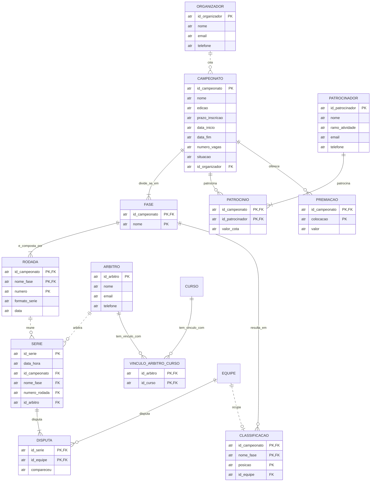
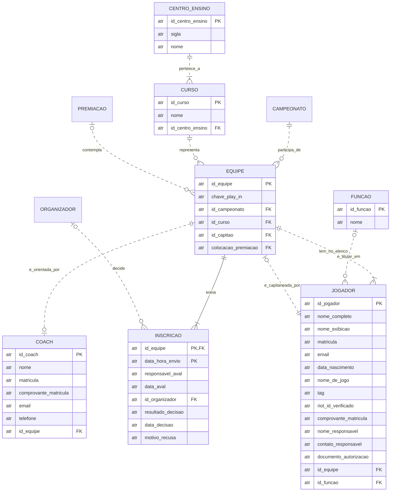
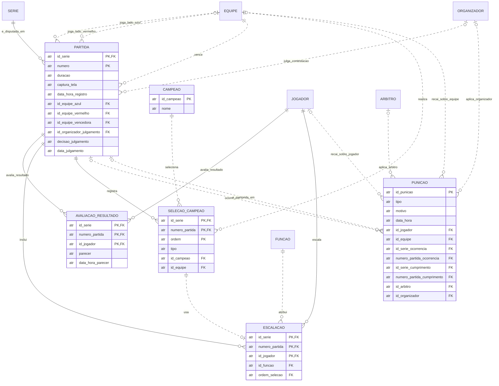

# 03 — Modelo Lógico (Esquema Relacional)

**Campeonato universitário de League of Legends — UFSC, campus Florianópolis**

CIN 8003 – Bancos de Dados e Aplicações · Prof. Moisés Lima Dutra · Aluno: Mateus Nunes Oliveira

> Feito a partir do MER (Parte 2). Sem tipos de dados e sem SQL: isso fica para o projeto físico. Os nomes já são os definitivos das tabelas e colunas.

---

## 2. Entidades → relações

Cada entidade virou uma relação com os mesmos atributos do MER. A lista completa está na seção 6. Ajustes:

- **Compostos:** entram só os componentes. periodo → data_inicio, data_fim; riot_id → nome_de_jogo, tag; contato → email, telefone; aval_curso → responsavel_aval, data_aval; autorizacao_responsavel → nome_responsavel, contato_responsavel, documento_autorizacao.
- **Multivalorados:** nenhum.
- **Derivados:** nenhum entra no esquema (idade, vitórias, derrotas, situações, colocação final etc.). Esses valores serão calculados por consulta.

---

## 3. Chaves

| Relação | PK | Chave candidata (vira UNIQUE) |
|---|---|---|
| ORGANIZADOR | id_organizador | — |
| CAMPEONATO | id_campeonato | (nome, edicao) |
| FASE | (id_campeonato, nome) | — |
| RODADA | (id_campeonato, nome_fase, numero) | — |
| SERIE | id_serie | — |
| DISPUTA | (id_serie, id_equipe) | — |
| CLASSIFICACAO | (id_campeonato, nome_fase, posicao) | id_equipe |
| ARBITRO | id_arbitro | — |
| VINCULO_ARBITRO_CURSO | (id_arbitro, id_curso) | — |
| CENTRO_ENSINO | id_centro_ensino | sigla; nome |
| CURSO | id_curso | nome |
| EQUIPE | id_equipe | (id_campeonato, id_curso); id_capitao |
| INSCRICAO | (id_equipe, data_hora_envio) | — |
| FUNCAO | id_funcao | nome |
| JOGADOR | id_jogador | — |
| COACH | id_coach | id_equipe |
| PARTIDA | (id_serie, numero) | — |
| AVALIACAO_RESULTADO | (id_serie, numero_partida, id_jogador) | — |
| CAMPEAO | id_campeao | nome |
| SELECAO_CAMPEAO | (id_serie, numero_partida, ordem) | (id_serie, numero_partida, id_campeao) |
| ESCALACAO | (id_serie, numero_partida, id_jogador) | (id_serie, numero_partida, ordem_selecao) |
| PUNICAO | id_punicao | — |
| PATROCINADOR | id_patrocinador | — |
| PATROCINIO | (id_campeonato, id_patrocinador) | — |
| PREMIACAO | (id_campeonato, colocacao) | — |

**FKs:** saem dos relacionamentos (seção 4) e estão marcadas na seção 6. A FK é obrigatória quando a participação mínima no MER é 1. **Aceitam NULL** (participação mínima 0):
- INSCRICAO.id_organizador (inscrição pendente);
- JOGADOR.id_funcao (reserva);
- PARTIDA.id_equipe_azul e id_equipe_vermelho (partida perdida por suspensão, P4);
- PARTIDA.id_organizador_julgamento;
- EQUIPE.colocacao_premiacao;
- todas as FKs de PUNICAO.

---

## 4. Relacionamentos

| R | Relacionamento (tipo) | Como ficou | Por quê |
|---|---|---|---|
| R01 | ORGANIZADOR cria CAMPEONATO (1:N) | CAMPEONATO.id_organizador | FK no lado N |
| R02 | CAMPEONATO divide-se em FASE (1:N) | id_campeonato na PK de FASE | entidade fraca |
| R03 | FASE é composta por RODADA (1:N) | (id_campeonato, nome_fase) na PK de RODADA | entidade fraca |
| R04 | RODADA reúne SERIE (1:N) | SERIE.(id_campeonato, nome_fase, numero_rodada) | FK no lado N |
| R05 | EQUIPE disputa SERIE (N:M) | **DISPUTA** (id_serie, id_equipe, compareceu) | N:M; compareceu fica na associativa |
| R06 | ARBITRO arbitra SERIE (1:N) | SERIE.id_arbitro | FK no lado N |
| R07 | FASE resulta em CLASSIFICACAO (1:N) | (id_campeonato, nome_fase) na PK de CLASSIFICACAO | entidade fraca |
| R08 | EQUIPE ocupa CLASSIFICACAO (1:1) | CLASSIFICACAO.id_equipe, UNIQUE | 1:1 (quadro abaixo) |
| R09 | EQUIPE participa de CAMPEONATO (1:N) | EQUIPE.id_campeonato | FK no lado N |
| R10 | EQUIPE representa CURSO (1:N) | EQUIPE.id_curso | FK no lado N |
| R11 | CURSO pertence a CENTRO_ENSINO (1:N) | CURSO.id_centro_ensino | FK no lado N |
| R12 | EQUIPE envia INSCRICAO (1:N) | id_equipe na PK de INSCRICAO | entidade fraca |
| R13 | ORGANIZADOR decide INSCRICAO (1:N) | INSCRICAO.id_organizador + resultado_decisao, data_decisao, motivo_recusa | FK no lado N; atributos vão junto |
| R14 | EQUIPE tem no elenco JOGADOR (1:N) | JOGADOR.id_equipe | FK no lado N |
| R15 | EQUIPE é capitaneada por JOGADOR (1:1) | EQUIPE.id_capitao, UNIQUE | 1:1 (quadro abaixo) |
| R16 | EQUIPE é orientada por COACH (1:1) | COACH.id_equipe, UNIQUE | 1:1 (quadro abaixo) |
| R17 | JOGADOR é titular em FUNCAO (1:N) | JOGADOR.id_funcao | FK no lado N |
| R18 | ARBITRO tem vínculo com CURSO (N:M) | **VINCULO_ARBITRO_CURSO** (id_arbitro, id_curso) | N:M |
| R19 | SERIE é disputada em PARTIDA (1:N) | id_serie na PK de PARTIDA | entidade fraca |
| R20 | EQUIPE joga no lado azul (1:N) | PARTIDA.id_equipe_azul | FK no lado N |
| R21 | EQUIPE joga no lado vermelho (1:N) | PARTIDA.id_equipe_vermelho | FK no lado N |
| R22 | EQUIPE vence PARTIDA (1:N) | PARTIDA.id_equipe_vencedora | FK no lado N |
| R23 | JOGADOR avalia resultado da PARTIDA (N:M) | **AVALIACAO_RESULTADO** (id_serie, numero_partida, id_jogador, parecer, data_hora_parecer) | N:M; atributos na associativa |
| R24 | ORGANIZADOR julga contestação (1:N) | PARTIDA.id_organizador_julgamento + decisao_julgamento, data_julgamento | FK no lado N; atributos vão junto |
| R25 | PARTIDA inclui ESCALACAO (1:N) | (id_serie, numero_partida) na PK de ESCALACAO | entidade fraca |
| R26 | ESCALACAO escala JOGADOR (1:N) | id_jogador na PK de ESCALACAO | entidade fraca |
| R27 | ESCALACAO atribui FUNCAO (1:N) | ESCALACAO.id_funcao | FK no lado N |
| R28 | PARTIDA registra SELECAO_CAMPEAO (1:N) | (id_serie, numero_partida) na PK de SELECAO_CAMPEAO | entidade fraca |
| R29 | SELECAO_CAMPEAO seleciona CAMPEAO (1:N) | SELECAO_CAMPEAO.id_campeao | FK no lado N |
| R30 | EQUIPE realiza SELECAO_CAMPEAO (1:N) | SELECAO_CAMPEAO.id_equipe | FK no lado N |
| R31 | ESCALACAO usa SELECAO_CAMPEAO (1:1) | ESCALACAO.ordem_selecao, UNIQUE | 1:1 (quadro abaixo) |
| R32 | PATROCINADOR patrocina CAMPEONATO (N:M) | **PATROCINIO** (id_campeonato, id_patrocinador, valor_cota) | N:M; valor_cota na associativa |
| R33 | CAMPEONATO oferece PREMIACAO (1:N) | id_campeonato na PK de PREMIACAO | entidade fraca |
| R34 | PREMIACAO contempla EQUIPE (1:N) | EQUIPE.colocacao_premiacao (com EQUIPE.id_campeonato) | FK no lado N |
| R35 | PUNICAO recai sobre JOGADOR (1:N) | PUNICAO.id_jogador | FK no lado N |
| R36 | PUNICAO recai sobre EQUIPE (1:N) | PUNICAO.id_equipe | FK no lado N |
| R37 | PUNICAO ocorre em PARTIDA (1:N) | PUNICAO.(id_serie_ocorrencia, numero_partida_ocorrencia) | FK no lado N |
| R38 | PUNICAO é cumprida em PARTIDA (1:N) | PUNICAO.(id_serie_cumprimento, numero_partida_cumprimento) | FK no lado N |
| R39 | ARBITRO aplica PUNICAO (1:N) | PUNICAO.id_arbitro | FK no lado N |
| R40 | ORGANIZADOR aplica PUNICAO (1:N) | PUNICAO.id_organizador | FK no lado N |

**Relacionamentos 1:1.** Nos quatro casos, uma entidade existe sem a outra e as duas têm PK própria. Por isso não há fusão: a FK fica no lado obrigatório, com UNIQUE.

| R | Uma existe sem a outra? | FK em |
|---|---|---|
| R08 | equipe sem classificação (só 8 têm) | CLASSIFICACAO |
| R15 | jogador que não é capitão | EQUIPE (id_capitao) |
| R16 | equipe sem coach | COACH |
| R31 | banimento sem jogador | ESCALACAO |

**Capitão:** EQUIPE aponta para JOGADOR e JOGADOR aponta para EQUIPE. Por isso id_capitao fica vazio até o elenco ser cadastrado, e a aprovação da inscrição exige que ele esteja preenchido.

---

## 5. Casos especiais

**Entidades fracas:** a PK é a PK da dona mais o discriminador.

| Fraca | PK |
|---|---|
| FASE | id_campeonato + nome |
| RODADA | (id_campeonato, nome_fase) + numero |
| PARTIDA | id_serie + numero |
| INSCRICAO | id_equipe + data_hora_envio |
| ESCALACAO | (id_serie, numero_partida) + id_jogador (duas donas) |
| SELECAO_CAMPEAO | (id_serie, numero_partida) + ordem |
| CLASSIFICACAO | (id_campeonato, nome_fase) + posicao |
| PREMIACAO | id_campeonato + colocacao |

> No físico (Parte 4), cada PK composta vira a chave substituta `id_<tabela>` + UNIQUE(PK da forte, discriminador). Assim, as tabelas que referenciam a fraca usam uma FK simples (ex.: `id_partida`).

**Multivalorados e autorrelacionamentos:** nenhum no MER.

---

## 6. Esquema relacional completo

**Legenda:** **negrito** = parte da PK · (PK) = chave primária · (FK → X) = chave estrangeira para X · (PK, FK → X) = as duas coisas · colunas entre parênteses = chave composta.

**Estrutura do campeonato**
- ORGANIZADOR (**id_organizador** (PK), nome, email, telefone)
- CAMPEONATO (**id_campeonato** (PK), nome, edicao, prazo_inscricao, data_inicio, data_fim, numero_vagas, situacao, id_organizador (FK → ORGANIZADOR))
- FASE (**id_campeonato** (PK, FK → CAMPEONATO), **nome** (PK))
- RODADA (**(id_campeonato, nome_fase)** (PK, FK → FASE), **numero** (PK), formato_serie, data)
- SERIE (**id_serie** (PK), data_hora, (id_campeonato, nome_fase, numero_rodada) (FK → RODADA), id_arbitro (FK → ARBITRO))
- DISPUTA (**id_serie** (PK, FK → SERIE), **id_equipe** (PK, FK → EQUIPE), compareceu)
- CLASSIFICACAO (**(id_campeonato, nome_fase)** (PK, FK → FASE), **posicao** (PK), id_equipe (FK → EQUIPE))
- ARBITRO (**id_arbitro** (PK), nome, email, telefone)
- VINCULO_ARBITRO_CURSO (**id_arbitro** (PK, FK → ARBITRO), **id_curso** (PK, FK → CURSO))
- PATROCINADOR (**id_patrocinador** (PK), nome, ramo_atividade, email, telefone)
- PATROCINIO (**id_campeonato** (PK, FK → CAMPEONATO), **id_patrocinador** (PK, FK → PATROCINADOR), valor_cota)
- PREMIACAO (**id_campeonato** (PK, FK → CAMPEONATO), **colocacao** (PK), valor)

**Equipes e pessoas**
- CENTRO_ENSINO (**id_centro_ensino** (PK), sigla, nome)
- CURSO (**id_curso** (PK), nome, id_centro_ensino (FK → CENTRO_ENSINO))
- FUNCAO (**id_funcao** (PK), nome)
- EQUIPE (**id_equipe** (PK), chave_play_in, id_campeonato (FK → CAMPEONATO), id_curso (FK → CURSO), id_capitao (FK → JOGADOR), colocacao_premiacao (FK → PREMIACAO, junto com id_campeonato))
- INSCRICAO (**id_equipe** (PK, FK → EQUIPE), **data_hora_envio** (PK), responsavel_aval, data_aval, id_organizador (FK → ORGANIZADOR), resultado_decisao, data_decisao, motivo_recusa)
- JOGADOR (**id_jogador** (PK), nome_completo, nome_exibicao, matricula, email, data_nascimento, nome_de_jogo, tag, riot_id_verificado, comprovante_matricula, nome_responsavel, contato_responsavel, documento_autorizacao, id_equipe (FK → EQUIPE), id_funcao (FK → FUNCAO))
- COACH (**id_coach** (PK), nome, matricula, comprovante_matricula, email, telefone, id_equipe (FK → EQUIPE))

**Partida, draft e punições**
- PARTIDA (**id_serie** (PK, FK → SERIE), **numero** (PK), duracao, captura_tela, data_hora_registro, id_equipe_azul (FK → EQUIPE), id_equipe_vermelho (FK → EQUIPE), id_equipe_vencedora (FK → EQUIPE), id_organizador_julgamento (FK → ORGANIZADOR), decisao_julgamento, data_julgamento)
- AVALIACAO_RESULTADO (**(id_serie, numero_partida)** (PK, FK → PARTIDA), **id_jogador** (PK, FK → JOGADOR), parecer, data_hora_parecer)
- CAMPEAO (**id_campeao** (PK), nome)
- SELECAO_CAMPEAO (**(id_serie, numero_partida)** (PK, FK → PARTIDA), **ordem** (PK), tipo, id_campeao (FK → CAMPEAO), id_equipe (FK → EQUIPE))
- ESCALACAO (**(id_serie, numero_partida)** (PK, FK → PARTIDA), **id_jogador** (PK, FK → JOGADOR), id_funcao (FK → FUNCAO), ordem_selecao (FK → SELECAO_CAMPEAO, junto com id_serie e numero_partida))
- PUNICAO (**id_punicao** (PK), tipo, motivo, data_hora, id_jogador (FK → JOGADOR), id_equipe (FK → EQUIPE), (id_serie_ocorrencia, numero_partida_ocorrencia) (FK → PARTIDA), (id_serie_cumprimento, numero_partida_cumprimento) (FK → PARTIDA), id_arbitro (FK → ARBITRO), id_organizador (FK → ORGANIZADOR))

**Total:** 25 relações (21 entidades + 4 associativas).

### Diagrama

Feito em Mermaid, em vez do Visual Paradigm. O código do esquema inteiro está em `diagramas/esquema_relacional.mmd`; aqui ele aparece dividido em 3 áreas. Uma relação de outra área aparece só com o nome. Linha cheia = a FK faz parte da PK; linha tracejada = FK comum. `atr` ocupa a coluna de tipo, que o Mermaid exige (os tipos são da Parte 4).

**Área 1 — Estrutura do campeonato, arbitragem, patrocínio e premiação**

**Área 2 — Equipes e pessoas**

**Área 3 — Partida, draft e punições**

---

## 7. Normalização

| Relação | 1FN | 2FN | 3FN | Observação |
|---|---|---|---|---|
| Relações com PK simples (ORGANIZADOR, CAMPEONATO, SERIE, ARBITRO, CENTRO_ENSINO, CURSO, FUNCAO, EQUIPE, JOGADOR, COACH, CAMPEAO, PUNICAO, PATROCINADOR) | ✔ | ✔ | ✔ | Na 1FN, os compostos já foram divididos. Com PK simples, a 2FN é automática. Na 3FN, o nome do centro fica em CENTRO_ENSINO, não em CURSO. |
| FASE, VINCULO_ARBITRO_CURSO | ✔ | ✔ | ✔ | só têm atributos de chave |
| RODADA | ✔ | ✔ | ✔ | o formato depende da rodada, não só da fase: nos Playoffs muda (Md3, Md3, Md5) |
| DISPUTA | ✔ | ✔ | ✔ | compareceu depende da série e da equipe juntas |
| CLASSIFICACAO | ✔ | ✔ | ✔ | id_equipe depende da fase e da posição juntas |
| INSCRICAO | ✔ | ✔ | ✔ | aval e decisão são de cada envio, não da equipe (reenvio, RN09) |
| PARTIDA | ✔ | ✔ | ✔ | duração e vencedora são de cada partida, não da série |
| AVALIACAO_RESULTADO | ✔ | ✔ | ✔ | parecer depende da partida e do capitão juntos |
| SELECAO_CAMPEAO | ✔ | ✔ | ✔ | campeão e equipe dependem da partida e da ordem juntas |
| ESCALACAO | ✔ | ✔ | ✔ | a função depende da partida, porque o jogador pode trocar de função (RN20) |
| PATROCINIO, PREMIACAO | ✔ | ✔ | ✔ | cota e valor mudam de uma edição para outra |

**Resultado:** nenhuma relação violou a 3FN, então nada foi decomposto.

---

## 8. Validação

| Pergunta | Resposta |
|---|---|
| Todas as entidades viraram relações? | Sim: 21 entidades + 4 associativas = 25 relações. |
| Todos os relacionamentos foram representados? | Sim, os 40 (seção 4). |
| Cardinalidades preservadas? | Sim. Mínimo 1 → FK obrigatória; mínimo 0 → FK que aceita NULL; 1:1 → FK UNIQUE. Quantidades exatas, como 6 jogadores e 2 equipes, ficam com a aplicação. |
| Atributos de relacionamento no lugar certo? | Sim: compareceu, parecer e valor_cota ficam nas associativas; a decisão fica em INSCRICAO e o julgamento em PARTIDA. |
| Algum dado se perdeu ou ficou repetido? | Não: nada foi decomposto, e os derivados são calculados por consulta. |
| Os casos de uso continuam atendidos? | **UC01:** SERIE → DISPUTA → PARTIDA → ESCALACAO e SELECAO_CAMPEAO → AVALIACAO_RESULTADO. **UC02:** EQUIPE → JOGADOR e COACH → INSCRICAO. |

**Onde cada RN é garantida.** "Aplicação" = a regra é conferida por consulta de auditoria; CHECK = restrição declarada no físico.

| RN | No esquema | Aplicação / CHECK |
|---|---|---|
| RN01 | EQUIPE.id_curso; UNIQUE(id_campeonato, id_curso) | — |
| RN02 | JOGADOR.id_equipe, id_funcao | 6 jogadores, um por função |
| RN03 | JOGADOR.matricula, comprovante_matricula | curso da matrícula |
| RN04 | JOGADOR.id_equipe | matrícula única no campeonato |
| RN05 | JOGADOR.nome_de_jogo, tag, riot_id_verificado | Riot ID único no campeonato |
| RN06 | EQUIPE.id_capitao (UNIQUE) | capitão da própria equipe |
| RN07 | COACH.id_equipe (UNIQUE) | coach não ser jogador |
| RN08 | JOGADOR.data_nascimento, dados do responsável | exigir autorização do menor |
| RN09 | INSCRICAO; CAMPEONATO.prazo_inscricao, numero_vagas | prazo; mínimo de 16 |
| RN10 | RODADA.formato_serie; EQUIPE.chave_play_in | sorteio e folga |
| RN11 | DISPUTA | emparelhamento |
| RN12 | CLASSIFICACAO | 3 vitórias / 3 derrotas |
| RN13 | DISPUTA | confronto repetido |
| RN14 | CLASSIFICACAO.posicao | desempate |
| RN15 | CLASSIFICACAO.posicao | montar as quartas |
| RN16 | RODADA.formato_serie | CHECK: Md1, Md3 ou Md5 |
| RN17 | PARTIDA; RODADA.formato_serie | fim da série |
| RN18 | PK de DISPUTA (a mesma equipe não entra duas vezes) | 2 equipes ativas |
| RN19 | PARTIDA.id_equipe_azul, id_equipe_vermelho | CHECK: azul ≠ vermelho; escolha do lado |
| RN20 | ESCALACAO.id_funcao | 5 por equipe, um por função |
| RN21 | UNIQUE(partida, id_campeao) em SELECAO_CAMPEAO | jogador suspenso |
| RN22 | SELECAO_CAMPEAO.tipo, id_campeao | campeão repetido na série |
| RN23 | SERIE.data_hora | choque de horário |
| RN24 | SERIE.id_arbitro; VINCULO_ARBITRO_CURSO | conflito de interesse |
| RN25 | PARTIDA.id_equipe_vencedora; AVALIACAO_RESULTADO; julgamento em PARTIDA | prazo de 24 h |
| RN26 | DISPUTA.compareceu | tolerância de 15 min |
| RN27 | PUNICAO | CHECK: um alvo e um aplicador; 3 advertências |
| RN28 | PATROCINIO.valor_cota; PREMIACAO.valor; EQUIPE.colocacao_premiacao | cotas ≥ premiação |
| RN29 | JOGADOR.nome_de_jogo, tag | troca autorizada |
| RN30 | INSCRICAO.responsavel_aval, data_aval | exigir aval |
| RN31 | JOGADOR.id_equipe | troca de jogador |
| RN32 | PARTIDA.captura_tela | CHECK: obrigatória se a partida tem lados |
| RN33 | DISPUTA.compareceu | W.O. duplo |
| RN34 | PUNICAO.tipo, partida de cumprimento | — |
| RN35 | PATROCINADOR.ramo_atividade | CHECK: ramos vedados |

---

## Diferenças em relação ao MER

1. **FUNCAO e CENTRO_ENSINO ganharam id artificial** (id_funcao, id_centro_ensino); nome e sigla viraram UNIQUE. Assim, as FKs já ficam com o nome final usado no físico.
2. **EQUIPE.id_capitao fica vazio até o elenco ser cadastrado** (no MER, (1,1)), porque EQUIPE e JOGADOR apontam um para o outro.
3. **RN04 e RN05 passam para a aplicação**, porque JOGADOR não guarda o campeonato (ele vem pela equipe).
4. **RN32 vira CHECK condicional:** a partida perdida por suspensão (P4) não tem captura de tela.
5. **Os atributos derivados não viraram colunas** (seção 2).

---

## Referências

HEUSER, Carlos Alberto. **Projeto de banco de dados**. 6. ed. Porto Alegre: Bookman, 2009.
